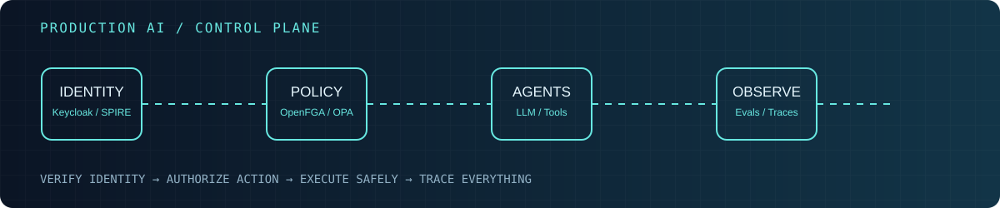

<div align="center">

<br/><br/>
<a href="https://github.com/data-guru0/data-guru0/tree/main/docs"></a>
<a href="https://www.linkedin.com/in/sudhanshu-gusain976/"></a>
<a href="https://youtube.com/channel/UCYJJtmZyW_zP_3hfCMp-EsQ"></a>

<sub> `AI SYSTEMS ENGINEERING` &nbsp; • &nbsp; `AGENTIC AI` &nbsp; • &nbsp; `GOVERNANCE` &nbsp; • &nbsp; `CLOUD NATIVE` </sub>
</div>

<br/>

<table>
<tr>
<td width="58%" valign="top">

### `01 / THE PERSON BEHIND THE SYSTEMS`

# Hi, I'm Sudhanshu. 👋

**I turn ambitious AI prototypes into systems that can be trusted.**

AI engineer · Technical educator · Systems builder.

My focus is where **agentic intelligence meets real-world engineering**: identity, authorization, policy, infrastructure, model evaluation, traceability and reliable deployment.

I also teach practical AI and data science through **Data Guru**, making advanced engineering approachable through project-based Hindi-language education.

**My operating principle:** *Identity before access. Policy before execution. Observability at every boundary.*

</td>
<td width="42%" valign="top">

<br/>
<sub>📍 India &nbsp; • &nbsp; 🌐 Building and teaching globally</sub>
</td>
</tr>
</table>

---

### `02 / MY ENGINEERING DNA`

<table>
<tr>
<td width="33%" align="center"><h2>🧠 BUILD</h2><b>Intelligent Systems</b><br/><sub>Agents · RAG · LLM gateways · Model routing</sub></td>
<td width="33%" align="center"><h2>🛡️ GOVERN</h2><b>Trusted Autonomy</b><br/><sub>Identity · Authorization · Policy · Audit</sub></td>
<td width="33%" align="center"><h2>🚀 SHIP</h2><b>Production Infrastructure</b><br/><sub>CI/CD · GitOps · Kubernetes · Observability</sub></td>
</tr>
</table>

<div align="center">

</div>

---

### `03 / PROJECT SPOTLIGHT`

<table>
<tr>
<td width="50%" valign="top">

#### [🤖 Multi-AI-Agent Projects](https://github.com/data-guru0/MULTI-AI-AGENT-PROJECTS)

**AGENTIC AI / PUBLIC CODE**

Practical experiments and projects exploring multi-agent workflows and orchestration.

<a href="https://github.com/data-guru0/MULTI-AI-AGENT-PROJECTS"></a>

</td>
<td width="50%" valign="top">

#### [🔍 GitHub PR Code AI Reviewer](https://github.com/data-guru0/GitHub-PR-Code-AI-Reviewer)

**AI DEVELOPER TOOLS / PUBLIC CODE**

AI-assisted pull-request review engineering.

<a href="https://github.com/data-guru0/GitHub-PR-Code-AI-Reviewer"></a>

</td>
</tr>
<tr>
<td valign="top">

#### [🎌 Anime Recommender · LLMOps](https://github.com/data-guru0/ANIME-RECOMMENDER-SYSTEM-LLMOPS)

**RECOMMENDATIONS / PUBLIC CODE**

Recommendation-system engineering with an LLMOps focus.

<a href="https://github.com/data-guru0/ANIME-RECOMMENDER-SYSTEM-LLMOPS"></a>

</td>
<td valign="top">

#### [🛍️ Flipkart Product Recommender](https://github.com/data-guru0/FLIPKART-PRODUCT-RECOMMENDER-SYSTEM)

**RECOMMENDER SYSTEMS / PUBLIC CODE**

Product-recommendation project in an e-commerce setting.

<a href="https://github.com/data-guru0/FLIPKART-PRODUCT-RECOMMENDER-SYSTEM"></a>

</td>
</tr>
</table>

<details>
<summary><b>▸ OPEN THE ARCHITECTURE LAB — selected system designs</b></summary>

<br/>

| Architecture | What it explores |
|:--|:--|
| **Custodian** | Five-layer governance for bank accounts-payable AI agents |
| **Nexa Gateway** | Unified LLM API, smart routing, provider registry, traces and feedback |
| **ReturnGuard** | Retail returns agents, policy enforcement, audit and human oversight |
| **NexaBank Fraud Copilot** | Identity propagation, ReBAC, separation of duties and confused-deputy prevention |

<sub>Architecture and teaching case studies; no public source-code claim is made for these systems.</sub>

</details>

---

### `04 / THE STACK — SELECTED FOR THE PROBLEM`

<table>
<tr><td><b>⚡ AI & Agents</b></td><td>LangGraph · RAG · MCP · DeepEval · MLflow · LLM gateways</td></tr>
<tr><td><b>🔐 Trust & Governance</b></td><td>Keycloak · SPIFFE/SPIRE · OpenFGA · OPA · Vault · Presidio</td></tr>
<tr><td><b>☁️ Platform Engineering</b></td><td>Docker · Kubernetes · Terraform · Jenkins · Argo CD · AWS</td></tr>
<tr><td><b>🧩 Backend & Data</b></td><td>Python · FastAPI · Go · PostgreSQL · Redis · Qdrant</td></tr>
<tr><td><b>📡 Observability</b></td><td>Langfuse · ELK · Prometheus · Grafana</td></tr>
</table>

<details>
<summary><b>▸ OPEN THE TERMINAL — how I think about production AI</b></summary>

```text
$ cat engineering-principles.yaml

identity:       verify humans AND workloads
authorization:  check every sensitive action
policy:         enforce guardrails at runtime
data:           know provenance and protect privacy
models:         evaluate before and after release
operations:     instrument, monitor, and recover
delivery:       automate the path to production

$ echo "Build. Govern. Ship."
Build. Govern. Ship.
```

</details>

---

### `05 / SIGNALS FROM GITHUB`

<div align="center">


<br/>

<br/>
<sub>Live third-party widgets may be temporarily unavailable or cached.</sub>
</div>

---

### `06 / BUILD IN PUBLIC. TEACH IN PUBLIC.`

<div align="center">

**Complex systems deserve clear explanations.**

Through my AI engineering projects, educational content and architecture walkthroughs, I explore what it actually takes to make AI systems dependable.

<a href="https://github.com/data-guru0?tab=repositories"></a>
<a href="https://www.linkedin.com/in/sudhanshu-gusain976/"></a>

<br/><br/>

`> engineering intelligence. governing autonomy.`


</div>