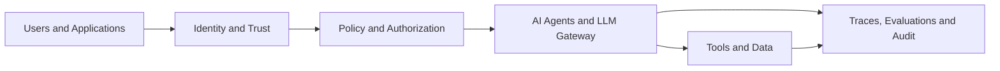

 

**Production AI · Agentic Systems · AI Governance · MLOps · Cloud Native**

*Building AI systems that are not just intelligent — but secure, observable, and ready to ship.*

---

### `> whoami`

I'm **Sudhanshu Gusain** — an AI engineer, technical educator, and builder exploring how to take AI from demos to dependable systems.

I work across **agentic AI, LLM infrastructure, AI governance, cloud-native engineering, and MLOps**. Through **Data Guru**, I also make hands-on AI and data science education accessible in Hindi.

<table><tr><td width="33%"><b>01 / BUILD</b> Multi-agent systems, RAG, LLM gateways</td><td width="33%"><b>02 / GOVERN</b> Identity, authorization, policies, observability</td><td width="33%"><b>03 / TEACH</b> Project-first, practical engineering education</td></tr></table>

### `> featured_repositories`

<table>
<tr>
<td width="50%" valign="top"><h3>🤖 Multi-AI-Agent Projects</h3>Experiments and hands-on work with multi-agent AI architectures.  <a href="https://github.com/data-guru0/MULTI-AI-AGENT-PROJECTS"><b>Explore repository →</b></a></td>
<td width="50%" valign="top"><h3>🔎 GitHub PR Code AI Reviewer</h3>AI-assisted code review project for pull-request workflows.  <a href="https://github.com/data-guru0/GitHub-PR-Code-AI-Reviewer"><b>Explore repository →</b></a></td>
</tr>
<tr>
<td valign="top"><h3>🎌 Anime Recommender · LLMOps</h3>Recommendation-system project with an LLMOps engineering focus.  <a href="https://github.com/data-guru0/ANIME-RECOMMENDER-SYSTEM-LLMOPS"><b>Explore repository →</b></a></td>
<td valign="top"><h3>🛍️ Flipkart Product Recommender</h3>Recommendation-system project grounded in e-commerce data.  <a href="https://github.com/data-guru0/FLIPKART-PRODUCT-RECOMMENDER-SYSTEM"><b>Explore repository →</b></a></td>
</tr>
</table>

### `> systems_i_design`

| System | Engineering focus |
| :--- | :--- |
| **Custodian** | Multi-agent bank invoice processing with identity, policy, data, model, and operational governance |
| **Nexa Gateway** | Self-hosted LLM gateway design with unified APIs, smart routing, credentials, traces, and feedback |
| **ReturnGuard** | Governed retail returns workflow with multiple agents, policy checks, and reviewer oversight |

Selected architecture/capstone work; public source links are included only where verified.

### `> technology_map`

| Layer | Technologies |
| :--- | :--- |
| **AI / Agents** | LangGraph · RAG · MCP · DeepEval · MLflow |
| **Identity & Governance** | Keycloak · SPIFFE/SPIRE · OpenFGA · OPA · Vault · Presidio |
| **Infrastructure** | Docker · Kubernetes · Terraform · Jenkins · Argo CD · AWS |
| **Backend & Data** | Python · FastAPI · Go · PostgreSQL · Redis · Qdrant |
| **Observability** | Langfuse · ELK · Prometheus · Grafana |

<b>🧠 Explore my production AI architecture philosophy</b>

**Identity before access. Policy before execution. Observability at every boundary.**

<b>🎓 What I teach and explore</b>

- Building and deploying AI systems end to end
- AI governance, agent identity, authorization, and policy enforcement
- CI/CD, GitOps, Kubernetes, and infrastructure as code
- LLMOps, RAG, evaluation, observability, and MCP gateways
- Project-based AI and data science education in Hindi

### `> github_activity`

Statistics are rendered by a third-party service and may occasionally be unavailable.

---

### Let's build systems that last.

[**Explore code**](https://github.com/data-guru0?tab=repositories) · [**Connect on LinkedIn**](https://www.linkedin.com/in/sudhanshu-gusain976/) · [**Learn on YouTube**](https://youtube.com/channel/UCYJJtmZyW_zP_3hfCMp-EsQ)

Engineering intelligence. Governing autonomy.

