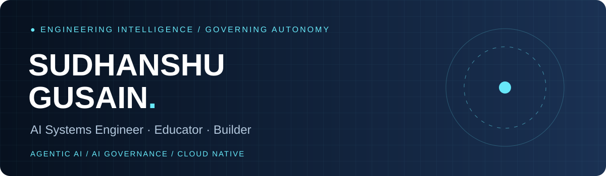
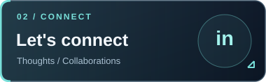
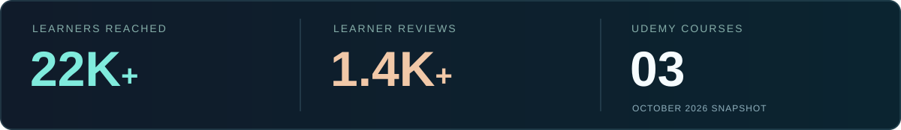
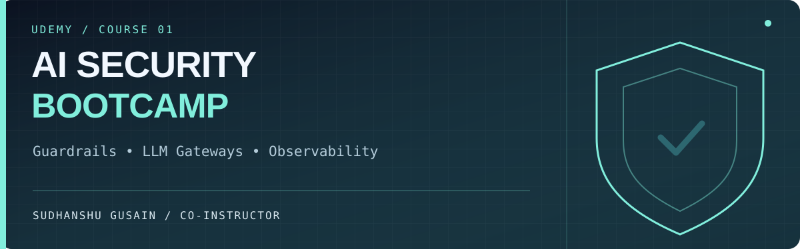
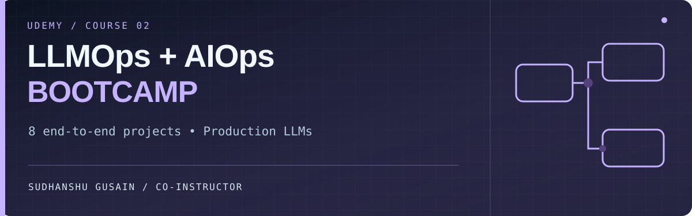
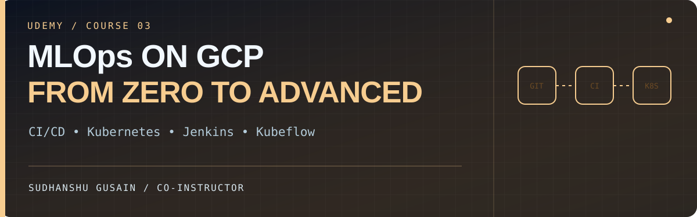

 

&nbsp;
&nbsp;

  

✦ AI ENGINEERING &nbsp;·&nbsp; LLMOPS &nbsp;·&nbsp; AI GOVERNANCE &nbsp;·&nbsp; MLOPS &nbsp;·&nbsp; EDUCATION ✦

 

 
Teaching impact from my public <a href="https://www.udemy.com/user/sudhanshu-gusain-3/">Udemy instructor profile</a> (October 2026 snapshot; figures evolve over time).

 

## `01 / THE HUMAN BEHIND THE CODE`

<table>
<tr>
<td width="70%" valign="top">

<h2>Hey! I'm Sudhanshu 👋</h2>

I'm an <b>AI engineer, Udemy instructor, and technical content creator</b> from India.

Most people know me through code, technical walkthroughs, or my courses. But what really drives me is something simple: <b>making complex engineering understandable and useful.</b>

I work at the intersection of <b>AI systems, cloud infrastructure, MLOps, and AI security</b>. I enjoy the entire journey — understanding how something works, building it, breaking it, improving it, and finally teaching it in a way that clicks.

Through <b>Udemy</b> and <b>Data Guru</b>, I share what I'm learning and building with people who want more than just another tutorial.

<b>My belief?</b> The best way to understand technology is to build with it. The best way to master it is to explain it.

</td>
<td width="30%" align="center" valign="top">

  
<b>ENGINEER × EDUCATOR</b>
 
📍 India • 🌍 Teaching worldwide

</td>
</tr>
</table>

---

## `02 / THE CLASSROOM — WHERE I SHARE WHAT I BUILD`

<h3>🎓 My Udemy courses</h3>

Real engineering. Practical demos. The why <i>and</i> the how.

I'm a co-instructor on **three published Udemy courses**, covering the journey from production ML infrastructure to secure, observable AI agents.

### 01 — AI Security Bootcamp

**[AI Security Bootcamp — Guardrails, LLM Gateways, Observability ↗](https://www.udemy.com/course/ai-security-bootcamp-guardrailsllm-gatewaysobservability/)**

How do you move beyond *"the model works"* to *"the system is safe to operate"*? This course explores **LLM gateways, guardrails, evaluations, observability, red teaming, and production AI agent engineering**.

Co-created with the KrishAI instructor team, including Krish Naik and fellow instructors.

### 02 — LLMOps & AIOps Bootcamp

**[LLMOps And AIOps Bootcamp With 8 End To End Projects ↗](https://www.udemy.com/course/llmops-and-aiops-bootcamp-with-9-end-to-end-projects/)**

An end-to-end, project-driven journey through **LLM applications, CI/CD, Docker, Kubernetes, cloud deployment, monitoring, and production workflows**.

### 03 — MLOps on GCP

**[Beginner to Advanced MLOps on GCP — CI/CD, Kubernetes, Jenkins ↗](https://www.udemy.com/course/mastering-advanced-mlops-on-gcp-cicd-kubernetes-kubeflow/)**

From development to deployment: **ML pipelines, Jenkins, GitLab CI, Kubernetes, Kubeflow, Google Cloud, and monitoring**.

 

---

## `03 / THE CREATOR — DATA GURU`

<table>
<tr>
<td width="65%" valign="top">
<h3>🎥 Making deep tech easier to learn.</h3>

Outside structured courses, I share engineering concepts, hands-on experiments, and longer technical walkthroughs on <b>YouTube</b>.

Through <b>Data Guru</b>, I've focused on making data science, machine learning, and AI more approachable — including practical Hindi-language learning.

My interests have grown from data science and ML to <b>production AI systems, DevOps, agent infrastructure, and governance</b>. The curiosity is the same: learn it deeply enough that I can explain it clearly.

<a href="https://www.youtube.com/channel/UCYJJtmZyW_zP_3hfCMp-EsQ"><b>Watch my YouTube channel →</b></a>
</td>
<td width="35%" valign="top" align="center">

<pre>LEARN
  ↓
BUILD
  ↓
BREAK
  ↓
UNDERSTAND
  ↓
TEACH
  ↻</pre>
My favorite feedback loop.

</td>
</tr>
</table>

---

## `04 / WHAT I'M EXPLORING RIGHT NOW`

<table>
<tr>
<td width="33%" valign="top">

### 🧠 Intelligent systems

**Agentic AI · LLMOps · RAG**

Building AI applications with multiple tools, models, and agents — with the practical engineering needed to make them useful.

</td>
<td width="33%" valign="top">

### 🛡️ Responsible systems

**AI Governance · Security · Evals**

Thinking about who can access what, how policies are enforced, how data is protected, and how AI systems are evaluated.

</td>
<td width="33%" valign="top">

### ☁️ Reliable systems

**MLOps · Cloud · Platform**

Designing repeatable build, deployment, monitoring, and operations workflows for AI workloads.

</td>
</tr>
</table>

<b>🧰 Open my engineering toolbox</b>

 

| What I work on | Technologies and concepts |
| :-- | :-- |
| **AI engineering** | Python, FastAPI, LangGraph, RAG, MCP, vector search |
| **AI governance and security** | Keycloak, SPIFFE/SPIRE, OpenFGA, OPA, Vault, Presidio |
| **MLOps and LLMOps** | MLflow, model evaluation, CI/CD, LLM gateways, observability |
| **Cloud and platform** | Docker, Kubernetes, Jenkins, Argo CD, Terraform, AWS, GCP |
| **Data and backend** | PostgreSQL, Redis, Qdrant, Go |
| **Monitoring** | Prometheus, Grafana, ELK, Langfuse |

These represent technologies and areas I work with or teach, not an exhaustive expertise ranking.

---

## `05 / A LITTLE OF MY CODE`

My GitHub is where I share practical course examples, experiments, and engineering projects. If you'd like to see implementation rather than just hear me talk about it:

- 🤖 **[Multi-AI-Agent Projects](https://github.com/data-guru0/MULTI-AI-AGENT-PROJECTS)** — exploring AI agent workflows.
- 🔍 **[GitHub PR Code AI Reviewer](https://github.com/data-guru0/GitHub-PR-Code-AI-Reviewer)** — AI-assisted developer workflows.
- 🎌 **[Anime Recommender / LLMOps](https://github.com/data-guru0/ANIME-RECOMMENDER-SYSTEM-LLMOPS)** — a project from the recommendation-systems and LLMOps world.

**[→ Browse all my repositories](https://github.com/data-guru0?tab=repositories)**

<b>📊 Curious about my GitHub activity?</b>

 

 
Third-party statistics may be cached or temporarily unavailable.

---

## `06 / THE PART THAT MATTERS MOST`

### "I don't want people to just copy commands.
### I want them to understand why those commands exist."

I believe **good engineering and good teaching have a lot in common**: both require clarity, curiosity, patience, and attention to the details that everyone else skips.

Whether you're here to explore my code, learn from a course, collaborate, or simply say hello — welcome!

 

&nbsp;

  

MADE WITH CURIOSITY · BUILT WITH INTENTION · SHARED WITH THE WORLD

